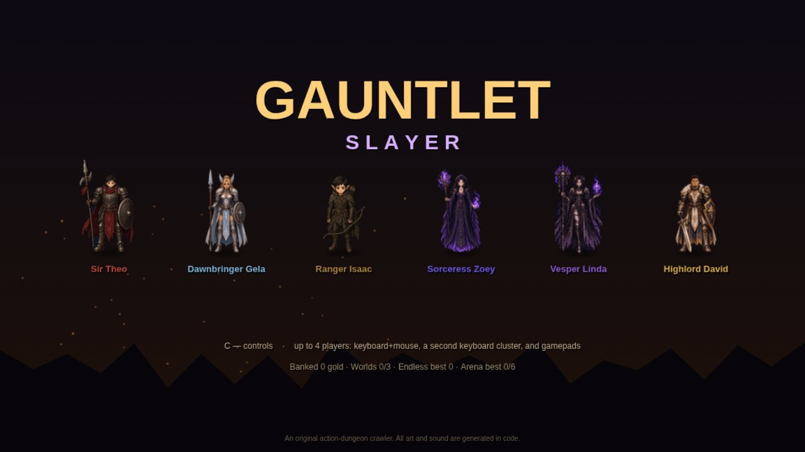
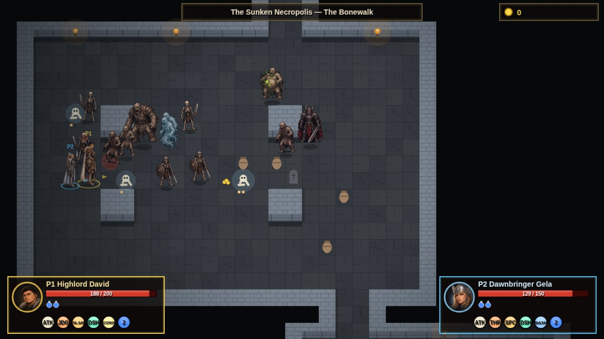
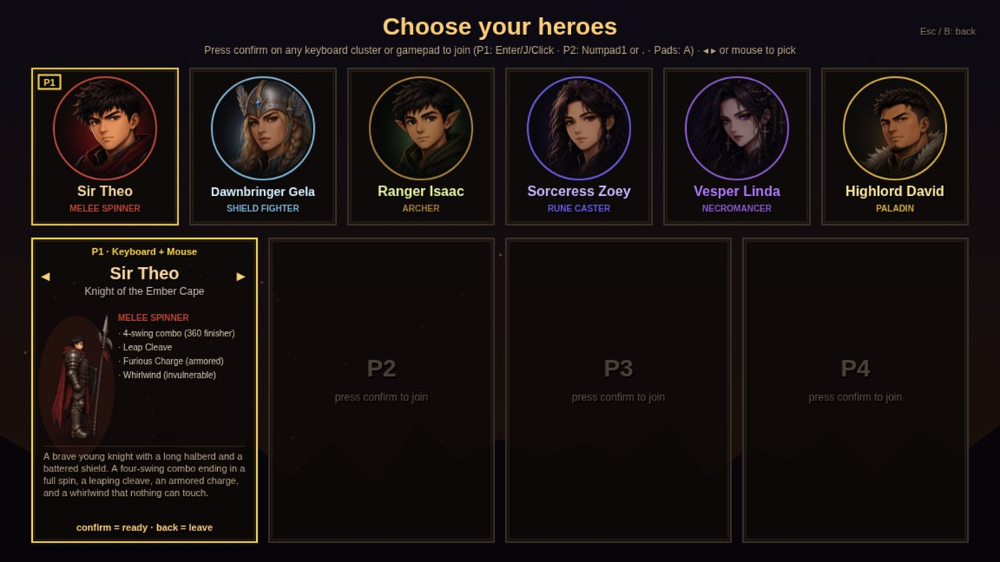
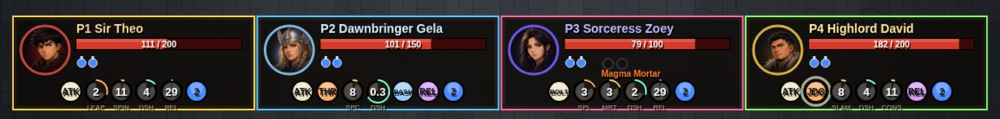

# Gauntlet Slayer

**Grab up to three friends, pick a hero and hack your way through monster-packed dungeons, all on one screen.**

  <a href="https://tedzoe.github.io/GauntletSlayer/"><b>▶&nbsp;&nbsp;PLAY NOW: tedzoe.github.io/GauntletSlayer</b></a> 
  Free, in your browser. Nothing to install.

  

## About

Gauntlet Slayer is a fast co-op action dungeon crawler in the spirit of the classic **Gauntlet: Slayer Edition** (2015).

- Up to **4 players on one screen**: keyboard and mouse, a second keyboard player, and any gamepads.
- **Six heroes**, each with their own combos, charged attacks, a dash and a signature ability.
- Big battle rooms full of monsters, spawners, traps and treasure. Smash the spawners, grab the gold and find the exit.
- Three worlds with bosses and a final showdown, plus an Endless descent and a daily arena.

## The heroes

| Hero | Class | Play style |
|---|---|---|
| **Sir Theo** | Warrior | A halberd knight with a four-swing combo, a leaping cleave and an armored charge. His Whirlwind spin can't be touched. |
| **Dawnbringer Gela** | Valkyrie shield fighter | Spear and shield. Block and reflect missiles, bash, lunge and shield-charge, or throw her shield. |
| **Ranger Isaac** | Archer | Quick and nimble. Rapid shots, a charged sniper shot that pierces everything, a combat roll and bombs. |
| **Sorceress Zoey** | Wizard | Combines two of three runes (Ember, Rime, Storm) to prime one of nine spells, then casts it. |
| **Vesper Linda** | Necromancer and summoner | Reaps essence from foes, raises skeletons to fight for her, erupts bone spikes and ghostwalks through enemies. |
| **Highlord David** | Paladin | The toughest hero. A greatsword combo, a charged Judgment, a shield that throws missiles back and consecrated ground that heals allies. |

## How to play

**The goal:** fight through each floor, wreck the monster spawners, collect gold and treasure, and reach the exit. Clear the worlds, beat their bosses, and then take on the final area.

- **Worlds and floors:** there are three worlds, each with four floors ending in a boss:
  - The Sunken Necropolis
  - The Gloomroot Caverns
  - The Ember Foundry
  
  Beat all three to unlock **The Hollow Throne**.
- **Rooms wake up:** monsters in a room stay still until you walk in, until one of them spots you (walls block their view), or until you hit something in the room. Then the whole room comes for you.
- **Keys, gates and secrets:** keys open locked gates. Cracked walls hide side rooms with treasure. Look out for legendary chests, food and potions.
- **Gold banks at gates and exits:** gold you pick up is only safe once the party opens or walks through a gate, or crosses the floor's exit. Each hero banks their own share and sees a "+N banked" popup. If you retreat, quit or fall, you lose only the gold picked up since the last gate. Each potion you still hold at the exit is worth +500 gold.
- **The crown:** each floor has one crown hidden somewhere.
  - Whoever wears it gets **double gold**, but moves 10% slower and nearby enemies go after them first.
  - Any hit knocks it loose, and it vanishes if nobody grabs it within 5 seconds.
  - Still wearing it at the floor exit? That's **+500 gold**.
- **Death is coming:** the Pale Collector can't be killed. It hunts you through the Collector's Labyrinth and turns up on every 6th floor of Endless. Don't let it touch you. Run for the exit.
- **Falling in battle:** a fallen hero drops some of the unbanked gold. Press confirm to bring them back with a rez coin. Coins are unlimited on Easy and Normal, 3 on Hard and 1 on Unfair.
- **Camp, shop and relics:** between runs you rest at **Wayfarer's Rest**.
  - Spend your banked gold at the **Peddler** on alternate weapons, talismans (potion powers) and relics.
  - A relic is an extra active power on its own cooldown, with three ranks to buy.
  - The **Mastery Tablet** tracks lifetime feats that grant permanent bonuses.
- **Difficulty:** choose Easy, Normal, Hard or Unfair in Options. Hard and Unfair give more loot but limit your revives.
- **Extended Realms (optional):** turn this on in **Options → Gameplay rules** to add five extra areas to Endless, each with its own monsters, mini-boss and boss:
  - The Thornwild
  - The Rotting Fen
  - The Sunken Sands
  - The Rimefrost Wastes
  - The Ebon Citadel
  
  It is off by default.

## Game modes

| Mode | What it is |
|---|---|
| **Campaign** | Three worlds of four floors each, then the final area, The Hollow Throne. Floors include normal stages, a Reaper-haunted labyrinth or a pitch-dark or meteor-strewn run, an arena of monster waves, and a boss. |
| **Endless Descent** | Generated floors that cycle through the realms and get harder as you go (Hard from depth 19, Brutal from depth 37). Checkpoints let you jump back in deeper. |
| **Daily Arena** | The Proving Pit: survive 6 waves with two modifiers that change every day. |

## Controls

| Action | Keyboard + mouse | Second keyboard player | Gamepad |
|---|---|---|---|
| Move | WASD (arrows also work when playing solo) | Arrow keys | Left stick / D-pad |
| Aim | Mouse | Movement direction (with auto-aim) | Right stick |
| Primary attack | Left click / J | Numpad 1 / . | X |
| Secondary attack | Right click / K | Numpad 2 / / | Y |
| Defend / mobility | Left Shift / L | Numpad 3 / Right Shift | RT or R3 |
| **Dash** | F / Middle click | Numpad 6 / , | LT or L3 |
| Weapon ability | Space / I | Numpad 0 / Right Ctrl | B |
| Potion | Q | Numpad 4 / ; | LB |
| Relic | E | Numpad 5 / ' | RB |
| Confirm / interact | Enter / click | Numpad 1 / Numpad Enter | A |
| Pause | Esc / P | Numpad + | Start |

- **Zoey on a gamepad:** Y = Ember, X = Rime, B = Storm. Cast with the right stick or a trigger.
- **Joining:** to join, press confirm on the hero select screen or at camp.
- **Other keys:** M toggles sound. F toggles fullscreen on menus.
- **Cooldown bar:** every hero's moves sit in a bar under their health. Each one shows a countdown while it recharges and flashes when it's ready.

## Credits

Gauntlet Slayer is an **unofficial fan tribute** to Gauntlet: Slayer Edition. It is not affiliated with or endorsed by the owners of the Gauntlet name. All art and audio are original: the hero art is our own, and the monsters, levels, effects and sound are made in code.

<b>For developers</b>

- The game is plain HTML, CSS and JavaScript with no build step. To run it locally, serve the folder with any static server (for example `python3 -m http.server`) and open `index.html`.
- `tests/` holds the headless Chrome test suites (`cd tests && npm install && npm test`).
- `tools/sprite_pipeline/` holds the Python and Pillow hero sprite pipeline. Rebuild `assets.js` with `python3 tools/build_assets.py`.
- [`docs/slayer_ability_spec.md`](docs/slayer_ability_spec.md) is the design spec, covering hero kits, enemy rosters and rules.
- Numbers and balance live in `tuning.js`.
- Progress is saved in the browser's `localStorage`.

